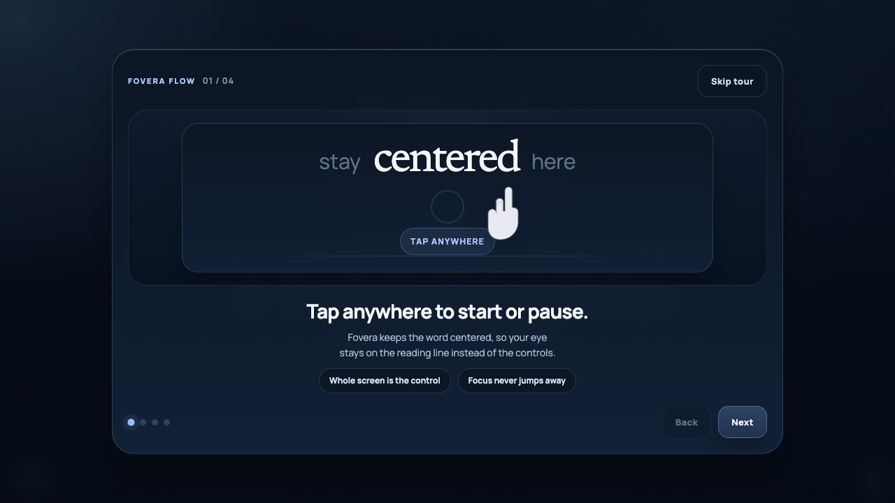

# Fovera

<p align="center">
  <strong>The new era of focused reading.</strong><br />
  A center-anchored reading experience where words move and your focus stays.
</p>

<p align="center">
  
  
  
  
</p>



## What Fovera Is

Fovera is a focused reading app built around the sharpest point of your vision.
Instead of forcing your eyes to chase lines across the page, Fovera keeps the
active word anchored at the center of the screen and lets the rest of the
experience move around that fixed point.

The result is a reading flow that feels calmer, more controlled, and more
intentional on both desktop and mobile web.

## Core Experience

- Center-anchored reading with one, two, or three visible focus words.
- Gesture-first controls for start, pause, speed, and vertical browsing.
- Bilingual reading with Turkish and English UI plus inline word translation.
- Local-first library with curated public-domain books and personal uploads.
- Theme studio with professional presets and customizable reader colors.
- Persistent progress, reading history, and session stats stored in the browser.

## Feature Highlights

### Focused reading engine

The primary reading surface is designed to reduce eye travel. The active word
stays fixed while surrounding context updates around it. Horizontal gestures
control pace; vertical gestures let the reader browse word-by-word without
breaking the visual anchor.

### Guided onboarding

Fovera includes a visual onboarding flow that teaches the product through
motion and interaction instead of a wall of text. New readers quickly learn how
to pause, change speed, browse vertically, and personalize the experience.

### Library built for actual reading

Fovera ships with a curated shelf of public-domain classics, bilingual reading
support, poster-style covers, current-reading recovery, and page-jump browsing.
Readers can also add their own content.

### Safe PDF import

PDF import is intentionally strict. The app accepts text-based PDFs and blocks
problematic files such as password-protected documents, embedded attachments,
JavaScript actions, unsupported XFA forms, and image-only scans with
insufficient selectable text.

### Theme studio

The settings experience supports theme preview before apply, custom contrast
control, and reader-centric color tuning for long sessions. Preset themes are
included, and custom combinations can be built on top of them.

### Local progress and reading memory

Fovera remembers the last selected book, reading position, session history,
theme selection, visible-word count, language choice, and translation
preferences through `localStorage`.

## Included Content

Fovera currently includes:

- 22 curated public-domain books in English
- Turkish first-party localizations aligned for in-app bilingual reading
- Source and verification notes for public-domain texts
- Cover assets and provenance notes for included artwork

Relevant documentation lives in:

- [`public/books/licenses/`](public/books/licenses/)
- [`public/books-tr/README.md`](public/books-tr/README.md)
- [`public/covers/README.md`](public/covers/README.md)
- [`public/covers/VERIFICATION-2026-07-18.md`](public/covers/VERIFICATION-2026-07-18.md)

## Tech Stack

| Layer | Choice |
| --- | --- |
| App shell | Vite |
| Language | TypeScript |
| Reader UI | Vanilla DOM rendering with a dedicated render layer |
| State | Lightweight local app state + `localStorage` persistence |
| PDF parsing | `pdfjs-dist` |
| Fonts | Newsreader Variable, Manrope Variable |
| Offline support | `vite-plugin-pwa` |

## Project Structure

```text
src/
  content/        Curated text assets, translation tables, content helpers
  core/           Parser, timers, shared types
  engine/         Reading logic, playback, gesture controller
  library/        Shelf management, upload flow, PDF import pipeline
  render/         DOM-facing render layer for the reading screen
  state/          App state, reader state, history persistence
  styles/         Main visual system
  utils/          Small UI and scheduling helpers
scripts/
  sync-public-domain-books.mjs
  generate-turkish-books.mjs
  generate-word-translations.mjs
public/
  books/          English public-domain texts
  books-tr/       Fovera-local Turkish editions for bilingual reading
  covers/         Cover artwork + provenance notes
```

## Getting Started

### Requirements

- Node.js 18+
- npm

### Install

```bash
npm install
```

### Run locally

```bash
npm run dev
```

### Production build

```bash
npm run build
npm run preview
```

### Type-check

```bash
npm run typecheck
```

## Available Scripts

```bash
npm run dev                       # start the local Vite server
npm run build                     # type-check + production build
npm run preview                   # preview the built app locally
npm run typecheck                 # TypeScript check without emitting files
npm run sync:public-domain-books  # refresh curated public-domain source files
npm run generate:turkish-books    # regenerate Turkish localizations
npm run generate:word-translations
```

## Upload Support

Readers can add personal books from the in-app library using:

- pasted plain text
- `.txt` uploads
- text-based `.pdf` uploads

Custom books are stored locally in the browser. Page breaks can be authored
with `---PAGE---` on its own line when importing plain text.

## Accessibility and Input Design

- Full-screen tap to start or pause
- Keyboard support for playback and pacing
- Reduced-motion aware transitions
- Screen-reader friendly labels on interactive UI
- Persistent pace, language, and theme settings

## Privacy Model

Fovera is currently designed as a local-first web app:

- reading progress is stored in the browser
- settings are stored in the browser
- personal uploads stay in the browser storage layer
- there is no required sign-in flow in this codebase

## Product Direction

Fovera is positioned as:

> A focused reading app that brings every word to the sharpest point of your
> vision.

Supporting product language:

- Words move. Your focus stays.
- Reading, centered.
- Keep your eyes still. Let words flow.

## Status

This repository contains the actively developed web experience for Fovera as of
July 18, 2026, including the reader engine, onboarding, theming system,
bilingual reading support, safe PDF import, curated public-domain shelf, and
local persistence model.
